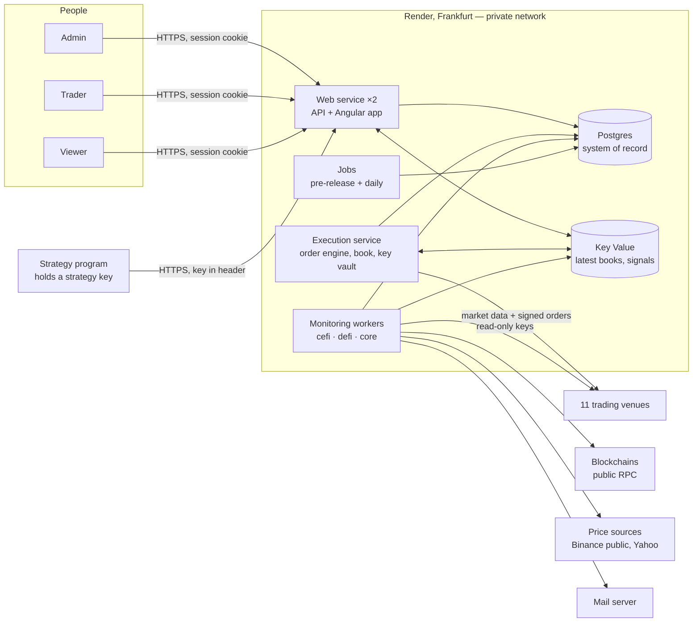
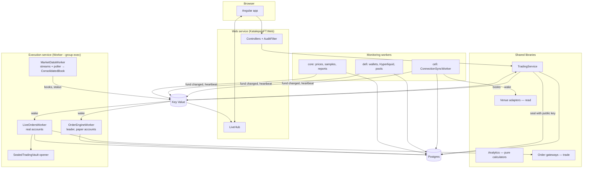
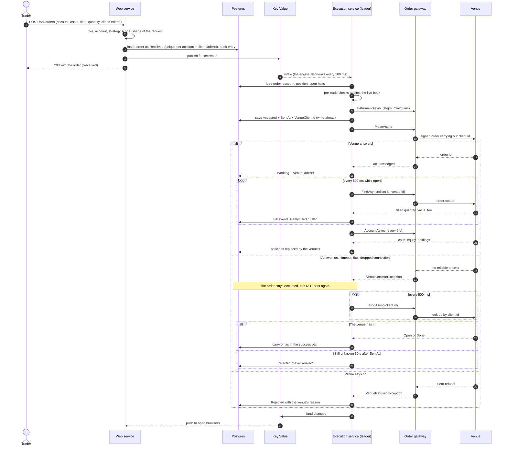
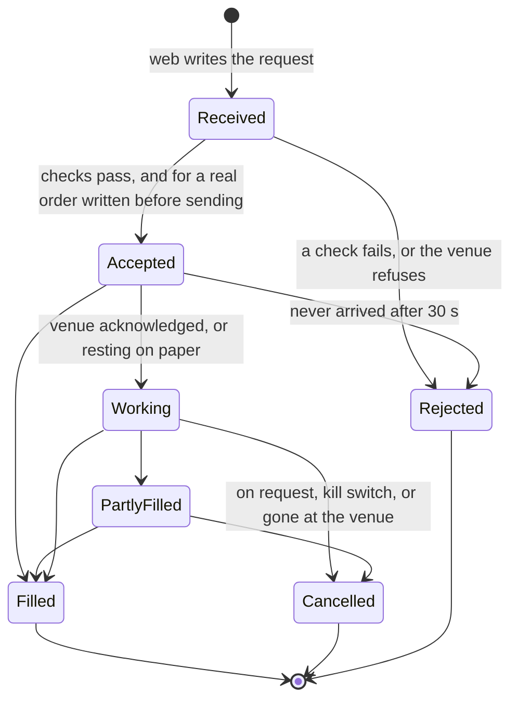

# Katalepsis FT — system architecture

Written 24 November 2026 against commit `68546d4`. Audience: the client's technical leadership, and the engineers who will build on, integrate with and operate the system.

This document describes the system as it is built today. It replaces the parts of `docs/architecture.md` and `docs/plan.md` that say the system is read-only: both were written before order execution was added and are kept as the record of the monitoring design and its decisions.

Every statement carries one of four standings:

| Label | Meaning |
|---|---|
| **Implemented** | In the repository and covered by tests or seen running on Render. The default when no label is given |
| **Specified** | Asked for by the owner or recorded in `docs/plan.md`, not built yet |
| **Proposed** | My recommendation; nobody has decided it |
| **Needs validation** | Built, but never seen working against the real thing |

Paths are relative to this repository. Paths that start with `Katalepsis:` are in the older Katalepsis repository (`outerlands-capital/katalepsis`, read at commit `9847e4f`).

---

## 1. Executive summary

**Business goal.** An allocator runs a master fund split into sleeves, each run by several managers, on many crypto venues. They need one place that shows what the fund holds and how it performs at every level (fund, sleeve, manager, asset), raises alerts, and lets authorised people send orders to the managers' venue accounts under limits, two-person approval and a kill switch.

**Recommended architecture (and what is built).** One codebase, one container image, six processes on Render, one Postgres database and one Key Value store:

- A **web service** serves the Angular app and the API. It never talks to a venue with a trading key and cannot open one.
- Three **monitoring workers** (cefi, defi, core) read accounts, wallets and prices and write books, samples and alerts.
- One **execution service** is the only process that acts on orders and the only one that can open trading keys. It keeps a consolidated order book from 11 venues and sends real orders to 10 of them.
- **Postgres is the system of record**; Key Value holds only what can be rebuilt (latest books, wake-up signals, heartbeats).

**Why it fits the constraints.**

- *Real money, small team, no staging.* The risky capability (sending orders, opening keys) is confined to one small process with its own secret; everything else is unable to trade by construction.
- *Many venues that each behave differently.* All venue differences sit behind two narrow contracts (`IVenueAdapter` for reading, `IOrderGateway` for trading); the engine has no venue-specific code.
- *An order must never be sent twice.* The order is written down as sent before it is sent, and an unclear answer is resolved by asking the venue, never by sending again (section 4).
- *Built on Katalepsis.* Katalepsis is about seven times the size of this system (237,500 lines of C#, 83 tables, 103 migrations, seven worker containers) and far more intricate. Its calculators, venue knowledge, conventions and lessons were carried over, which is why this system exists two days after its first commit and could not have without it (section 2.4).

**The most important open decision.** Where the execution service runs. It is in Frankfurt with the database; measured round trips from there are about 230–330 ms to Binance, Bybit, OKX, KuCoin, Bitget, Gate, MEXC and Hyperliquid, about 105 ms to Coinbase and 30–40 ms to Kraken and Deribit. Moving it close to the Asian venues cuts the venue leg but puts the order log a continent away from the engine, or forces the database to move too. Section 8, decision 9, and section 10, question 1.

**What has not happened yet.** No real order has been sent to any venue: no trading key has been entered. Every gateway is tested on recorded venue answers; eight were also checked against the real venues without a key. The first real order is the main acceptance check still open (section 9).

---

## 2. Scope and requirements

### 2.1 What this phase must prove

1. The same order path works for paper and real accounts, and a real order is sent **at most once** whatever fails.
2. Fills, fees and holdings shown for a real account are the venue's own, not our arithmetic.
3. Nobody can enable real trading, add a trading key, raise limits or release a halt alone.
4. A trading key cannot be read by the web service, the database administrator or the browser.
5. Monitoring (holdings, performance, risk, liquidity, alerts) keeps working when a venue, a worker or the execution service is down.

### 2.2 In scope

| Area | Standing | Where |
|---|---|---|
| Fund → sleeve → manager model, holdings drill-down and asset loop-back (R1–R7 of `docs/plan.md`) | Implemented | `src/KatalepsisFT.Application/Holdings/`, `src/KatalepsisFT.Web/Funds/FundsController.cs` |
| Performance against a benchmark, risk, volatility, liquidity, alerts with workflow (R8, R11) | Implemented | `src/KatalepsisFT.Analytics/`, `src/KatalepsisFT.Web/Performance/`, `Risk/`, `Alerts/` |
| Read-only connections to 10 CeFi venues, Hyperliquid, wallets on 10 chains, Uniswap v3 and Aerodrome pool positions | Implemented; no real read-only key tried on most venues (**needs validation**) | `src/KatalepsisFT.Venues/`, `docs/plan.md` phases 6–9 |
| Manual positions and CSV upload for traditional instruments (R9) | Implemented | `src/KatalepsisFT.Web/Manual/ManualController.cs` |
| Paper trading against the live consolidated book | Implemented | `src/KatalepsisFT.Application/Execution/ExecutionEngine.cs` |
| Real orders: spot and USDT perpetuals on KuCoin, Binance, Bybit, OKX, Bitget, Gate; USDC perpetuals on Deribit; spot on Coinbase Exchange, MEXC, Kraken | Implemented; **needs validation** with a real key | `src/KatalepsisFT.Venues/**/*OrderGateway.cs` |
| Two-person approval, kill switch, sealed key vault, audit trail, strategy keys | Implemented | `src/KatalepsisFT.Application/Execution/TradingService.cs` |
| Scheduled reports by mail | Implemented; mail account values not yet supplied | `src/KatalepsisFT.Web/Reports/ReportsController.cs`, `render.yaml` |

Not in scope today: Hyperliquid orders (needs wallet signing), MEXC perpetual orders, options and dated-futures orders, funding payments on perpetuals, smart order routing across venues, dYdX and GMX reading, a staging environment.

### 2.3 Constraints that shape the design

| Constraint | Source | Effect on the design |
|---|---|---|
| Production only, no staging | Decision A4, `docs/architecture.md` §11 | Safeguards live in CI, in backward-compatible migrations, in the demo fund and in paper mode |
| Direct pushes to `main`; deploy when CI passes | Decisions A6, C2 | CI builds the image and runs the pre-release migration step (`.github/workflows/ci.yml`) |
| Smallest paid Render tiers | Decision D8, `docs/plan.md` §12 | One image for all processes; polling where a stream is not worth a process |
| Secrets held as Render environment secrets | Decision A5 | Two master keys, the trading one given to one process only (`render.yaml`) |
| Same stack as Katalepsis | Decision D1 | .NET 8, Angular 21, ng-zorro, NGXS; copied code needs no translation |
| The build environment cannot reach Binance or Bybit | Observed (HTTP 451 and 403) | Those two gateways are tested on recorded answers only |

### 2.4 The Katalepsis foundation

**Katalepsis FT stands on Katalepsis.** It has no runtime link to it — separate repository, database and hosting, with code copied rather than referenced (`docs/plan.md` §1) — but what made this system possible is the accumulated work inside Katalepsis: a very large, very intricate trading platform whose calculations, venue knowledge and hard-won lessons were carried over. The measurements below show how much is in there, and why it had to be distilled into a new system rather than extended.

**How large and intricate Katalepsis is.** Measured at commit `9847e4f`, next to this system:

| Measure | Katalepsis | Katalepsis FT |
|---|---|---|
| Projects in the solution | 44 (`Katalepsis:Horizen.sln`) | 15 (`KatalepsisFT.sln`) |
| C# outside migrations | about 237,500 lines in 1,755 files | about 32,100 lines |
| – of which tests | about 72,700 lines, 2,048 test methods | about 7,900 lines, 370 test methods |
| Angular client | about 62,300 lines; 173 components in 38 modules | about 9,400 lines; 42 components |
| C# files over 1,000 lines | 42 | 1 (`TradingService.cs`) |
| C# product files over 500 lines | 65 | 7 |
| Database | three contexts, 83 tables, 103 migrations (MySQL) | one context, 29 tables, 13 migrations (Postgres) |
| API | 40 controllers, 236 endpoints, 171 MediatR handlers | 12 controllers, 101 endpoints |
| Background processing | 24 hosted services and 23 scheduled jobs, in 7 separately built containers | 6 hosted services in one image |
| Enumerations | 82 | 38 |
| Service registrations | 283 | — |
| Distinct packages referenced | 119 | 35 |
| Hosting | AWS: ECS, SQS, SNS, S3, DynamoDB, Athena, KMS, Secrets Manager; a separate OpenIddict sign-in server | Render; built-in sign-in |

Katalepsis is roughly seven times this system in code, three times in tables and eight times in schema history, and it is denser as well as larger:

- **One project holds most of it.** `Katalepsis:Application/` is about 105,000 lines; its `Services` folder alone is about 62,200 lines in 200 files, an average of over 300 lines a file.
- **Each venue is implemented many times over.** There is one trading service per venue and market type, each 800–1,170 lines: `Katalepsis:Application/Services/Markets/V2/Spot/CoinbaseExchangeMarketServiceV2.cs` (1,169), `MexcMarketServiceV2.cs` (1,114), `CoinbasePrimeMarketServiceV2.cs` (1,102), `KucoinMarketServiceV2.cs` (1,068), `BinanceMarketServiceV2.cs` (1,028), `BybitMarketServiceV2.cs` (1,011) — fourteen spot services and more for perpetuals and options. `Katalepsis:Application/Services/Markets/` is about 15,000 lines, on top of about 16,300 in `Katalepsis:Infrastructure/` for the venue clients underneath. The same venue appears again in the position watchers, the balance service and the RIA gateway.
- **The venue is a branch in the code, everywhere.** `MarketCode.` is referenced 654 times in 101 files, and the product code contains 261 `switch` statements. Adding a venue means finding and editing those places; in the position worker alone it is a `switch` with one near-identical method per venue (`Katalepsis:PerpetualPositionsWatcher/PerpetualPositionsWatcherWorker.cs:129-185`, `:250-374`).
- **Business logic sits in very large classes.** `Katalepsis:Application/Services/Bots/DiammV2/DiammMarketMakingV2Service.cs` (2,394 lines), `TriangleArbitrageService.cs` (2,319), `Katalepsis:Application/Services/Balance/BalanceService.cs` (2,205), `Katalepsis:Application/Services/Bots/DaoRebalancing/DaoRebalancingService.cs` (2,097), `CrossExchangeMarketMakingService.cs` (1,956), `AMMArbitrageService.cs` (1,908), `Katalepsis:Application/Services/Positions/PositionsWatcher.cs` (1,629). The tests mirror them: `Katalepsis:Application.Tests/Services/Bots/DiammMarketMakingV2ServiceTests.cs` is 2,479 lines.
- **It runs as many moving parts.** Seven worker containers, queues, a document store, a key service and a separate sign-in server have to be deployed and kept in step; the schema has been changed 103 times.
- **Its failure handling carries known traps.** Venue clients answer zero when a balance or position request fails, so a failed read looks like an empty account (`Katalepsis:Horizen.Ria/Integration/Venues/ExchangeVenueGateway.cs:60-61`, `:104-105`); some venues' position sizes arrive without a sign (`:136`); alert de-duplication lives in memory and is lost on restart (`Katalepsis:Application/Services/Positions/Perpetual/PerpetualPositionsWatcher.cs:34`).

**Why that matters here.** Every one of those numbers is also knowledge. The 14 spot services and their tests record how each venue really behaves; the 103 migrations record what a trading platform's data turns out to need; the large bot and balance services record the edge cases those strategies ran into. A team starting from an empty repository would have had to rediscover all of it. Katalepsis FT did not: it read Katalepsis, took what was sound, and designed around what was not. That is the reason a system of this breadth exists two days after its first commit (22 to 23 November 2026).

It is equally the reason this is a new system. A change of this size inside a 237,000-line codebase with 654 venue branch points, 83 tables and seven deployed workers could not have been made at this speed or with this isolation of risk.

**What Katalepsis FT takes from it.**

| Taken | Evidence in this repository |
|---|---|
| Code copied unchanged, with its tests: return, volatility, Sharpe, Sortino, drawdown; covariance and shrinkage; the chart component; the decimal pipe; the public market-data client | Header comments naming the source file and commit in `src/KatalepsisFT.Analytics/Performance/BacktestMetricsCalculator.cs`, `src/KatalepsisFT.Analytics/Statistics/Indicators.cs`, `src/KatalepsisFT.Web/ClientApp/src/app/shared/ria-chart.component.ts`, `shared/dynamic-decimal.pipe.ts`, `src/KatalepsisFT.Infrastructure/MarketData/BinancePublicClient.cs`, `tests/KatalepsisFT.Analytics.Tests/Statistics/IndicatorTests.cs` |
| Valuation and return rules: how spot, perpetuals and options add up to NAV; daily return with cash flows | `src/KatalepsisFT.Analytics/Valuation/PositionValuer.cs`, `src/KatalepsisFT.Analytics/Performance/ReturnCalculator.cs` |
| Which venue calls to make and how to sign them, for seven of the eleven read connections: Binance, Bybit, OKX, KuCoin, MEXC, Deribit, Coinbase | Class comments in `src/KatalepsisFT.Venues/Binance/BinanceAdapter.cs`, `Bybit/BybitAdapter.cs`, `Okx/OkxAdapter.cs`, `Kucoin/KucoinAdapter.cs`, `Mexc/MexcAdapter.cs`, `Deribit/DeribitAdapter.cs`, `Coinbase/CoinbaseHttp.cs` |
| Order calls for two of the ten gateways: Coinbase Exchange and MEXC spot | `src/KatalepsisFT.Venues/Coinbase/CoinbaseOrderGateway.cs`, `Mexc/MexcOrderGateway.cs` |
| Stack and conventions: library versions, layering, 8-decimal precision, NGXS, display rules | Decisions D1, A7, A9, A10 in `docs/plan.md` §12 and `docs/architecture.md` §11 |
| Design rules learned from its weak points: a failed read is an error and never an empty book; positions always signed; one bulk read per account; venues registered by name, never switched on | `docs/architecture.md` §1 (the Katalepsis facts) and §4 (the rules drawn from them) |

**What was written new**, with no Katalepsis source to follow: the fund → sleeve → manager model; the execution engine, paper matcher and consolidated book; the order gateways for KuCoin, Binance, Bybit, OKX, Bitget, Deribit, Gate and Kraken (from each venue's documentation); readers for Bitget, Gate, Kraken, Hyperliquid, wallets and pools; two-person approval, the sealed vault, the kill switch and the audit trail.

**What the evidence supports.** Without Katalepsis this system would not exist in its present form or on this timescale. The calculators arrived already tested; seven of the eleven venue readers and two of the order gateways started from calls Katalepsis already makes; the stack and conventions were settled; and the rules that make the new engine safe — a failed read is never an empty book, positions are always signed, venues are registered and never switched on — are direct answers to Katalepsis' own failure modes. The parts listed above as written new (the execution engine and eight of the ten gateways among them) have no Katalepsis source, and this document does not claim otherwise; they were designed with Katalepsis' lessons as their starting rules.

---

## 3. System structure

### 3.1 Actors

| Actor | Signs in with | May |
|---|---|---|
| Viewer | Session cookie | Read everything |
| Trader | Session cookie | Send and cancel orders, pull a kill switch, ask for its release |
| Admin | Session cookie | All of the above, plus structure, connections, users, trading accounts, keys, limits, approving other people's requests |
| Strategy program | `X-KFT-Strategy-Key` header | Send, cancel and read its own orders on the accounts its key names, up to the key's order size |
| Render operator | Render dashboard | Deploy, roll back, read logs, read environment secrets |

Roles are in `src/KatalepsisFT.Domain/Access/Roles.cs`, enforced by attributes on each endpoint (`src/KatalepsisFT.Web/Execution/TradingController.cs`); every endpoint requires a signed-in user unless it opts out (`src/KatalepsisFT.Web/Program.cs`, fallback policy).

### 3.2 Components

| Component | Responsibility | Owns |
|---|---|---|
| **Angular app** `src/KatalepsisFT.Web/ClientApp/` | Screens for funds, sleeves, managers, assets, risk, alerts, connections, trading | Nothing durable; selections in NGXS |
| **Web service** `src/KatalepsisFT.Web/` | API, sign-in, audit, live push to browsers, strategy API | Sessions; the decision to accept an order request and write it as `Received` |
| **TradingService** `src/KatalepsisFT.Application/Execution/TradingService.cs` | Validates requests, records orders, halts, approvals, limits, strategy keys; seals trading keys | The rules of who may ask for what |
| **Execution service** `src/KatalepsisFT.Worker/ExecutionWorker.cs` | The only actor on orders after `Received` | Order state, fills, positions of trading accounts, the consolidated book, the open trading keys |
| – MarketDataWorker | Holds one stream per venue and market type, publishes books every 250 ms and a status summary | `ft:book:*`, `ft:exec:status` in Key Value |
| – OrderEngineWorker + `ExecutionEngine` | Takes the leader lock; checks and fills paper orders against the live book | Paper orders and positions |
| – LiveOrdersWorker + `LiveExecution` | For real accounts: pre-trade checks, send, follow, cancel, read the venue account every 5 s | Real orders and positions |
| **Order gateways** `src/KatalepsisFT.Venues/**/*OrderGateway.cs` | Translate the contract in `src/KatalepsisFT.Application/Execution/Gateway.cs` into one venue's signed calls | Venue symbols, steps, error classification |
| **Monitoring workers** `src/KatalepsisFT.Worker/Program.cs` | cefi: read each key connection about once a minute; defi: wallets and Hyperliquid; core: price history, five-minute samples, manual books, reports | Books, samples, alerts, cash flows |
| **Venue adapters** `src/KatalepsisFT.Venues/` | Read a whole account in one normalised shape; check what a key may do | Nothing that trades: the contract has no such method |
| **Analytics** `src/KatalepsisFT.Analytics/` | Returns, risk, exposure, liquidity, valuation, with no I/O | Every number shown on screen |
| **Jobs** `src/KatalepsisFT.Jobs/Program.cs` | `deploy` before each release (migrations, roles, first Admin, demo fund), `demo` daily at 00:20 UTC, `check`, `migrate` | Schema changes |

### 3.3 Data stores

| Store | Holds | If lost |
|---|---|---|
| **Postgres 17** `katalepsis-ft-db` | Structure, connections with encrypted read keys, snapshots, samples, alerts, audit entries, users, session key ring, trading accounts, sealed trading keys, orders, order events, trading positions, halts, approvals, strategy key hashes, the vault key pair | Restored from Render point-in-time recovery; orders sent meanwhile are recovered from the venues by client id only if the order row survives |
| **Key Value** `katalepsis-ft-kv` | Latest venue books (`ft:book:{type}:{asset}`), book index, execution status (3 s life), wake channel `ft:exec:wake`, fund-changed channel, heartbeats | Refilled within seconds by the workers. Nothing durable lives here |

### 3.4 Trust boundaries

1. **Internet → web service.** The only inbound surface. TLS at Render; strict same-site, HTTP-only, secure cookie (`src/KatalepsisFT.Web/Program.cs`).
2. **Web service → execution service.** They share the database and Key Value but not the secret: `EXEC_MASTER_KEY` is declared on the execution worker alone (`render.yaml`). The web service can seal a trading key with the vault's public key; it cannot open one.
3. **Execution service → venues.** Outbound only. Trading keys must be able to trade and must not be able to withdraw.
4. **Monitoring workers → venues.** Read-only keys under a different secret (`MASTER_KEY`), refused at entry if they can trade or withdraw where the venue says.
5. **Render private network.** Postgres and Key Value accept no connection from outside (`ipAllowList: []` in `render.yaml`).

---

## 4. End-to-end workflow: a real order

The primary workflow is one order on a real account, from the ticket to the venue and back. A strategy program follows the same path through `api/strategy/orders`.

### 4.1 Success path and the most consequential failure

### 4.2 Step by step

| # | Component | What happens | State change |
|---|---|---|---|
| 1 | Web: `TradingController` → `TradingService.SubmitAsync` | Request shape, role, account exists, fund is not the demo, manager not retired, strategy key covers the account | Order row `Received`; audit entry |
| 2 | Web: `KeyValueExecutionSignal` | Publishes a wake. If Key Value is down the engine still finds the order on its next 100 ms round | None |
| 3 | Exec: `LiveOrdersWorker` → `LiveExecution` | Pre-trade checks (`PreTradeChecks` in `src/KatalepsisFT.Application/Execution/Book.cs`): halt in force, live market present (book younger than 2 s), price within the account's band, order and strategy size limits, position limit including working orders, reduce-only rules, no spot short | `Rejected` with a plain reason, or continue |
| 4 | Exec: gateway `InstrumentAsync` | Venue's quantity step, price step, smallest order. Quantity is rounded **down** to the step; a price that does not fit is refused | `Rejected` if too small or unlisted |
| 5 | Exec: write-ahead | `Accepted`, `SentAt`, `VenueClientId` (`kft{orderId}x{12 hex}`) are committed **before** the request leaves | `Accepted` |
| 6 | Gateway → venue | Market orders go out as immediate-or-cancel limits at the edge of the price band, so a thin book cannot fill them at any price | — |
| 7 | Exec: follow | Asks the venue for the order every 500 ms; applies whatever filled quantity, value and fee the venue reports | `Working` → `PartlyFilled` → `Filled` / `Cancelled`; `order_events` rows |
| 8 | Exec: account read | Every 5 s the venue's cash, equity and holdings replace our positions for that account; a failed read is recorded on the account and the last reading kept | `trading_positions`, `LiveEquityUsd`, `LiveSyncedAt`, `LiveSyncError` |
| 9 | Web: `LiveHub` | Browsers viewing the fund reload | — |

### 4.3 Retries, duplicates and recovery

| Situation | Behaviour | Why |
|---|---|---|
| The browser or strategy sends the same request twice | A unique index on (trading account, `ClientOrderId`) makes the second insert fail; the first order is returned (`TradingService.SubmitAsync`; `src/KatalepsisFT.Persistence/Configurations/ExecutionConfigurations.cs`) | The caller can retry safely |
| The venue's answer to the order is lost | Never resent. Looked up by our client id until found, or `Rejected` as "never arrived" 30 s after `SentAt` (`LiveExecution.GiveUpAfter`) | Sending again could double the position |
| The execution service dies between "write Accepted" and "send" | On restart the order is `Accepted` with a `SentAt`; it is looked up, not found, and rejected after 30 s | The cost is a lost order, never a duplicate |
| The execution service dies after sending | On restart the order is found at the venue by client id and followed | The client id is in Postgres before the request leaves |
| An acknowledged order disappears at the venue | After 10 s of "not found" it is closed as `Cancelled` at the venue (`GoneAfter`) | Venues drop cancelled, unfilled orders from their lookups |
| Two execution instances run | A Postgres advisory lock (`pg_try_advisory_lock(7302)`) on a held connection picks one leader; the other waits and checks every 2 s. Measured handover: 1–2 s | One actor per order |
| Two writers touch one order row | `Order.Version` is the Postgres `xmin` row version; the loser reloads | Web sets `CancelRequested` while the engine fills |
| A kill switch is pulled (account, venue or global) | New orders are refused; cancels are sent for every open order in scope, repeated every 3 s until the venue confirms | One person can stop; two are needed to resume |
| The venue cannot be reached for its trading rules | The order is rejected after 10 s without being sent (`RulesWait`) | Not sending is always safe |
| A venue stream goes quiet | Its book ages past 2 s and stops counting as a live market; orders for that venue are refused until it returns | No order is priced on stale data |

**The window that remains.** If a venue accepts an order but fails to answer for more than 30 s *and* cannot find it by client id during that time, the order is recorded as rejected while it exists at the venue. The 5-second account read will then show a holding or an open order that no order of ours explains. Detecting that mismatch and raising an alert is **proposed**, not built.

---

## 5. Data and integrations

### 5.1 Systems of record

| Fact | System of record | Note |
|---|---|---|
| That an order was asked for, by whom, with what limits | Postgres `orders`, `audit_entries` | |
| Whether a real order exists, what filled, at what fee | **The venue** | Postgres holds our copy, refreshed by `FindAsync` |
| What a real account holds and is worth | **The venue** | Read every 5 s; replaces our positions |
| What a paper account holds | Postgres `trading_positions` | Fees are approximations |
| Monitoring books | The venue or chain | Postgres holds the last complete read and its time |
| Structure, limits, approvals, halts, users | Postgres | |
| Daily prices | Binance public data, Yahoo Finance for shares | Yahoo's chart data is unofficial |

### 5.2 Identifiers

| Identifier | Made by | Used for |
|---|---|---|
| `Order.Id` | Postgres | Everything internal |
| `ClientOrderId` | The caller, or a GUID if absent; up to 64 characters | Making a repeated request return the same order |
| `VenueClientId` `kft{orderId}x{12 hex}` | Execution service, before sending; letters and digits only so every venue accepts it | Finding the order at the venue when its answer was lost |
| `VenueOrderId` | The venue | Faster lookups and cancels once known |
| Strategy key | Shown once at creation; only its SHA-256 hash is stored | Authenticating a strategy program |

### 5.3 Order states

Trading accounts move `Paper → Live` only through an approved `GoLive` request and need a stored key and no open paper orders; `Live → Paper` is refused while orders are open at the venue (`TradingService.RequestGoLiveAsync`, `BackToPaperAsync`).

### 5.4 Integration contracts

**Strategy API** (`src/KatalepsisFT.Web/Execution/TradingController.cs`, `StrategyController`): `POST api/strategy/orders`, `POST api/strategy/orders/{id}/cancel`, `GET api/strategy/orders/{id}`, `GET api/strategy/book/{type}/{asset}`, authenticated by the `X-KFT-Strategy-Key` header and rate-limited per caller. Refusals carry a sentence a person can act on.

**Order gateway** (`src/KatalepsisFT.Application/Execution/Gateway.cs`): six operations — instrument rules, place, cancel, find, account, and the venue's name. A gateway must classify every failure as `VenueRefusedException` (a clear no: safe to record as rejected) or `VenueUnclearException` (no reliable answer: the engine must look the order up). This classification is the whole safety contract, and it is the part most in need of validation against real venues.

**Venue adapter** (read): check a key's permissions; read a whole account as either a complete snapshot or a failure.

### 5.5 External dependencies: verified and to confirm

"Real venue, no key" means the gateway was run from the build environment against the venue's public rules and its refusal of a made-up key (`tests/KatalepsisFT.Venues.Tests/LiveVenueChecks.cs`, enabled with `LIVE_VENUE_CHECKS=1`). No row has been verified with a real trading key.

| Dependency | Used for | Verified | Still to confirm |
|---|---|---|---|
| KuCoin | Spot + perp orders, book, account read | Recorded answers; real venue, no key; key permissions readable | First real order; IP restriction needs Render's outbound addresses |
| Binance | Spot + perp orders, book, account read | Recorded answers only: the build environment is refused (HTTP 451) | Everything against the real venue, from Render |
| Bybit | Spot + perp orders, book, account read | Recorded answers only: refused (HTTP 403) | Everything against the real venue; account-wide margin mode is left as the account has it |
| OKX | Spot + perp orders, book, account read | Recorded answers; real venue, no key (REST) | Which host to use for the account's region; stream not reachable from the build environment |
| Bitget | Spot + perp orders, book, account read | Recorded answers; real venue, no key; key permissions readable | Behaviour on unified accounts as opposed to classic ones |
| Gate | Spot + perp orders, book, account read | Recorded answers; real venue, no key | Key permissions cannot be read |
| Deribit | USDC perpetual orders, book, account read | Recorded answers; real venue, no key | Liquidation price is not supplied |
| Coinbase Exchange | Spot orders (USD), book | Recorded answers; public rules only: a made-up key gets HTTP 500, which is treated as unclear | Refusal behaviour with a real key; key permissions cannot be read |
| MEXC | Spot orders, perp book (stream), spot book (REST every second) | Recorded answers; real venue, no key | Key permissions cannot be read; perpetual orders not built |
| Kraken | Spot orders (USD), book | Recorded answers; real venue, no key | Field names of its key-information answer |
| Hyperliquid | Perp book; account reading by address | Reading checked against two public accounts (`docs/plan.md` phase 9) | No order gateway; its book repeatedly reported "no data" in production summaries |
| Chains (EVM ×7, Solana, Bitcoin, Tron), Uniswap v3, Aerodrome | Wallet and pool reading | Each read against a real public address | Coverage limits listed in `docs/plan.md` phase 9; Solana's free endpoint throttles |
| Binance public market data | Daily and live prices | Running in production | An asset Binance does not list has no history |
| Yahoo Finance chart data | Share prices | Running | Unofficial, daily closes only, treated as USD |
| SMTP server | Scheduled reports | Sender implemented (`src/KatalepsisFT.Infrastructure/Mail/SmtpMailSender.cs`) | Account values not supplied; nothing is sent until they are |
| Render | Hosting, secrets, deploys | Running; pub/sub on Key Value confirmed (`docs/architecture.md` §12) | Key Value internal authentication is a dashboard switch not yet turned on (`docs/plan.md` phase 1) |

For every venue, the answer shape for "this order is unknown" is taken from documentation and recorded examples. It decides between "look again" and "reject", so it is the first thing to observe with a real key.

---

## 6. Deployment and operations

### 6.1 Environments and resources

One environment, production, on Render in Frankfurt, defined entirely by `render.yaml`:

| Resource | Type | Command |
|---|---|---|
| `katalepsis-ft-web` ×2 | web, Docker | `run.sh web`; pre-deploy `run.sh jobs deploy` |
| `katalepsis-ft-worker-core`, `-cefi`, `-defi` | worker | `run.sh worker <group>` |
| `katalepsis-ft-worker-exec` ×1 | worker | `run.sh worker exec` |
| `katalepsis-ft-daily` | cron, 00:20 UTC | `run.sh jobs demo` |
| `katalepsis-ft-db` | Postgres 17 | — |
| `katalepsis-ft-kv` | Key Value, no eviction | — |

One image (`Dockerfile`) holds the three executables and the built Angular app; `run.sh` picks one. The process runs as a non-root user.

There is no staging. The substitutes are: CI; the demo fund in production, read-only and excluded from totals; paper mode, which exercises the whole order path except the gateway; and the two-person `GoLive` approval per account.

### 6.2 Configuration and secrets

| Name | Given to | Purpose |
|---|---|---|
| `DATABASE_URL`, `KEYVALUE_URL` | All services | Wired by Render from the resources |
| `MASTER_KEY` | Web and monitoring workers (group `katalepsis-ft-secrets`) | Encrypts read-only venue keys (AES-256-GCM, `src/KatalepsisFT.Infrastructure/Security/CredentialVault.cs`) |
| `EXEC_MASTER_KEY` | Execution worker only | Protects the vault's private key. Changing it makes every stored trading key unreadable |
| `SMTP_*`, `MAIL_FROM` | Same group as `MASTER_KEY` | Report mail; empty means nothing is sent |
| `INITIAL_ADMIN_EMAIL`, `INITIAL_ADMIN_PASSWORD` | Web | First Admin, created by the `deploy` job |
| `EXEC_ASSETS` | Execution worker, optional | Which assets have books; default BTC, ETH, SOL, XRP, DOGE, BNB, LINK, AVAX, ADA, SUI |

Both master keys are generated by Render and never appear in the repository.

### 6.3 Release and rollback

1. Push to `main`. CI (`.github/workflows/ci.yml`) restores, builds, runs every test against a Postgres 17 service, runs the pre-release job's migration step, builds the Angular app and builds the image.
2. Render deploys each service whose files changed once CI passes (`autoDeployTrigger: checksPass`, `buildFilter`). A commit that touches only `tests/` or `docs/` deploys nothing. A commit whose CI failed is not deployed later by a passing tests-only commit; it needs a manual deploy.
3. The web service's pre-deploy command migrates the database before the new version starts. The two web instances are replaced one at a time, so **every migration must work with the previous version of the code**.
4. Workers restart on deploy. The execution service releases its leader lock explicitly, reconnects its streams and resumes following open orders from Postgres; real orders already at venues stay there untouched during the gap.
5. Rollback is Render's "roll back to a previous deploy" per service. A migration is not rolled back; that is why migrations only add.

**Proposed:** deploy the execution service on its own trigger rather than with every backend commit, since each restart is a few seconds in which open real orders are not followed.

### 6.4 Detecting and investigating failures

| Signal | Where | Tells you |
|---|---|---|
| `/health`, `/health/ready` | Web (`src/KatalepsisFT.Web/Program.cs`) | Process up; database, Key Value and worker heartbeats |
| System status page, `/api/system/status` | Admin | Per-worker heartbeat |
| Engine status on the trading page | `ft:exec:status`: leader, round time, per venue connected / books / round trip / last message | A venue stream down, a slow venue, no leader |
| Order timeline | `order_events` per order, shown on the ticket | Exactly what was sent, answered, filled, and every note |
| Account read badge | `LiveSyncedAt`, `LiveSyncError` on the trading account | The venue account has not been read, and why |
| Connections tab | Per connection: state, last read, our value next to the venue's | A monitoring read failing or disagreeing |
| Audit page with CSV export | `audit_entries` (`src/KatalepsisFT.Web/Audit/Audit.cs`) | Who did what, when |
| Render log stream | All services | The execution service logs a venue summary every 10 minutes |

Not built (**proposed**): alerts pushed to people when the execution service has no leader, a venue stream stays down, or an account read keeps failing. Today these are visible on screen but nobody is paged. Alert delivery to Slack is **specified** in `docs/plan.md` phase 5 and not built.

**Backups.** Render Postgres point-in-time recovery. A rehearsed restore is **specified** (`docs/architecture.md` §9) and has not been done.

---

## 7. Security and privacy

**Identity.** ASP.NET Identity with a cookie session (`kft_session`: HTTP-only, secure, strict same-site). Lockout for 15 minutes after five failed sign-ins (`src/KatalepsisFT.Persistence/DependencyInjection.cs`). The session key ring is stored in Postgres so either web instance accepts a session. Two-step sign-in is **not built**.

**Authorization.** Three roles (section 3.1) checked per endpoint; a fallback policy requires sign-in everywhere else. Strategy programs present a key whose hash is stored; a key names the accounts it may trade and its largest order, and can be switched off.

**Two-person approval.** Adding a trading key, raising limits, releasing a halt and switching an account to real money each create an `ApprovalRequest`. `TradingService.DecideAsync` refuses a decision by the person who made the request. With a single Admin, none of these can be done: the system needs at least two.

**Trading keys.** The browser sends the key to the web service once. The web service checks it with the venue, seals it with the vault's public key (RSA-3072 with OAEP wrapping a one-time AES-GCM key) and stores the sealed form. The private key is stored encrypted under `EXEC_MASTER_KEY`, which only the execution service holds (`src/KatalepsisFT.Infrastructure/Execution/ExecutionPlumbing.cs`, `SealedTradingVault`). Consequences:

- A copy of the database does not yield trading keys.
- A compromise of the web service yields keys in transit at the moment they are entered, not stored ones.
- Anyone who can read the execution worker's environment in Render can open every key. This is the accepted limit of decision A5.

**What a key may do.** A trading key is refused if the venue says it can withdraw, or cannot trade. Coinbase Exchange, Gate and MEXC do not say; such a key is accepted and the approval request states "NOT CHECKED" so the approver decides knowingly (`TradingService.UncheckableVenues`). Read-only monitoring keys are refused if they can trade or withdraw, where the venue says.

**Limits on every order.** Largest order, largest position (counting working orders), price band, leverage capped at 20×, per-strategy order size, and three scopes of kill switch.

**Sensitive data.** Venue credentials, manager names, positions and user emails. Credentials are never returned by the API (only a short hint) and never logged. There is no investor or customer personal data in the system.

**Transport and headers.** HSTS, `frame-ancestors 'none'`, no-referrer, rate limiting on the API and a stricter one on the strategy API (`src/KatalepsisFT.Web/Program.cs`).

**Auditability.** Every state-changing trading endpoint carries `[Audit(...)]`; the filter records the actor, the action, the object and the outcome. Orders additionally keep an append-only event list.

**Gaps.** No two-step sign-in; Key Value internal authentication not switched on; no IP allow-list for trading keys at venues that offer one; no periodic re-check that a stored trading key still cannot withdraw (**proposed**); the regulatory position of sending orders on managers' accounts has not been assessed (section 10).

---

## 8. Architecture decisions

| # | Choice | Rationale | Credible alternative | Trade-off | Revisit when |
|---|---|---|---|---|---|
| 1 | A new system on Katalepsis' stack and conventions, with code copied in | Katalepsis' size (section 2.4) makes it slow to change; its calculators and venue knowledge are reusable | Extend Katalepsis in place | Two codebases; fixes to copied code do not flow back | The two products need to share live data |
| 2 | One execution process is the only actor on orders; the web service only records requests | One place to reason about "sent once"; the trading secret lives in one process | Web service sends orders directly | An extra hop of a few milliseconds; the engine must be up to trade | Never for safety; measure if latency matters |
| 3 | Write-ahead, never resend, resolve by client id | A duplicate order costs money; a lost order costs an opportunity | Retry on timeout with the venue's idempotency | An order can be reported "never arrived" after 30 s | A venue is shown to guarantee idempotent placement by client id |
| 4 | Postgres as system of record and as leader lock | One durable store; no extra coordination service | A queue (SQS, as in Katalepsis) plus a lock service | The engine polls every 100 ms and depends on the database being close | Order volume makes row polling a bottleneck |
| 5 | Key Value only for rebuildable data and wake-ups | Losing it loses nothing | Durable streams in Key Value | The web service reads books a few hundred ms old | A consumer needs a replayable feed |
| 6 | Venue truth for fills and holdings on real accounts | Our arithmetic can drift; the venue's cannot | Compute positions from our own fills | Up to 5 s behind; depends on the account read | A venue offers a reliable private stream worth the complexity |
| 7 | Poll order status over REST every 500 ms rather than private streams | One mechanism for ten venues, simple to test | Private WebSocket per account | Slower fill notice; more REST calls | Fill latency or rate limits become a problem |
| 8 | Sealed vault: web can seal, only the execution service can open | Limits what a web or database compromise yields | One master key for all services; or an external KMS | Custody is still Render's environment; key rotation is manual | Client policy requires an HSM or KMS |
| 9 | Execution service in Frankfurt with the database | Engine-to-database round trips are the most frequent | Move execution (and the database, or only the engine) near the Asian venues | 230–330 ms to most venues today | **Now** — see section 10, question 1 |
| 10 | Market orders sent as immediate-or-cancel limits at the price band | A thin book cannot fill at any price | True market orders | May fill partly and cancel the rest | A strategy needs guaranteed completion |
| 11 | Two-person approval for the four dangerous changes | No single account, stolen or mistaken, can move to real money or lift a stop | Admin acts alone | Needs two Admins available | Never for real money |
| 12 | Production only; paper mode and the demo fund instead of staging | Cost and speed (decision A4) | A staging environment with venue testnets | A gateway change is first seen against the real venue in production | **Before real money at size** — see section 10, question 4 |
| 13 | Market data over public streams, one per venue and market type; MEXC spot by REST each second | Its spot stream requires a binary format not worth a dependency | Add the decoder | MEXC spot book is up to 1 s old | MEXC spot becomes a primary venue |

---

## 9. Delivery and validation

### 9.1 Order of work from here

| Step | Depends on | Observable acceptance check |
|---|---|---|
| 1. Decide where the execution service runs | Question 1 | Decision recorded; if moved, engine status shows round trips under an agreed figure |
| 2. Turn on Key Value internal authentication; add a second Admin | Render dashboard; a second person | Both visible in Render and on the Users page |
| 3. **First real order**, one venue, smallest size | A trading key that can trade and cannot withdraw; two Admins; step 2 | The order timeline shows sent → acknowledged → filled; quantity, price and fee equal the venue's own order history; the position equals the venue's |
| 4. Failure drills on that venue at smallest size | Step 3 | (a) Restart the execution service with an order resting: it is followed after restart, not resent. (b) Pull the account kill switch: the order is cancelled at the venue within seconds. (c) Send the same `clientOrderId` twice: one order exists at the venue. (d) Send an order the venue will refuse: `Rejected` with the venue's reason |
| 5. Repeat 3–4 per venue, Binance and Bybit first | Step 4 | Same checks; these two have never been reached from the build environment |
| 6. Unexplained-holding alert and operator alerts (**proposed**) | — | Placing an order by hand at the venue raises an alert within a minute |
| 7. Hyperliquid gateway, MEXC perpetuals, funding payments | Questions 5–6 | Per item, as step 3 |
| 8. Restore rehearsal | — | A point-in-time restore produces a database the services start against |

### 9.2 What the current build tests, and what it cannot

About 480 test cases run in CI (`tests/`). The ones that carry the claims of section 2.1:

| Claim | Test |
|---|---|
| Duplicate requests, limits, halts, approvals, roles | `tests/KatalepsisFT.Web.Tests/Execution/ExecutionApiTests.cs`, `UsersApiTests.cs` |
| Write-ahead, lost answer, never arrived, gone at venue, kill switch cancel, venue account replaces positions | `tests/KatalepsisFT.Web.Tests/Execution/LiveExecutionTests.cs` |
| Each gateway's signing, rounding and failure classification on recorded answers | `tests/KatalepsisFT.Venues.Tests/KucoinOrderGatewayTests.cs`, `MoreOrderGatewayTests.cs` |
| Streams parse each venue's book and survive silence | `tests/KatalepsisFT.Infrastructure.Tests/MarketStreamTests.cs` |
| Calculators | `tests/KatalepsisFT.Analytics.Tests/` |

Assumptions only a real key can test: that each venue accepts our client id format on a live order; that "unknown order" answers look as documented; that fees are reported in a form we convert correctly; that the account read matches the venue's own screen; that rate limits tolerate 500 ms status polling with several open orders.

Needed before real money at size, beyond the above: two-step sign-in; operator alerts; the unexplained-holding check; a decision on staging; a decision on key custody.

---

## 10. Open questions

| # | Question | Decision it blocks | Evidence that would resolve it |
|---|---|---|---|
| 1 | Should the execution service move closer to the Asian venues, and does the database move with it? | Deployment topology; whether latency-sensitive strategies are viable | Which venues and strategy styles matter most to the fund; a measurement of engine round time with the database in another region |
| 2 | Is Render's environment acceptable custody for the secret that opens trading keys? | Whether a KMS or HSM is needed before real money | The client's security policy; who has Render workspace access |
| 3 | Are keys from venues that do not state permissions (Coinbase Exchange, Gate, MEXC) acceptable for real trading? | Whether those three go live | A policy decision; or venue-side controls such as sub-accounts without withdrawal addresses |
| 4 | Is production-only still right now that real orders are sent? | Whether to build a staging environment on venue testnets | Which venues offer a testnet whose behaviour matches production; the cost of one more Render environment |
| 5 | Is Hyperliquid trading wanted? | Adding a wallet-signing dependency and a gateway | Owner's priority; a review of the signing library to be used |
| 6 | Are funding payments, options and dated futures needed in execution? | Scope of the next phase | The strategies the managers will run |
| 7 | What is the regulatory position of sending orders on managers' venue accounts? | Go-live with real money | Advice from the client's counsel |
| 8 | How should an order that exists at a venue but is recorded as "never arrived" be handled: alert only, or adopt it? | Design of the unexplained-holding check | How often venues answer late, observed in step 4 of section 9.1 |
| 9 | Does 500 ms status polling stay within each venue's rate limits with many open orders? | Whether private streams are needed | Rate-limit responses counted during step 5 |
| 10 | Why does Hyperliquid's book report "no data" in production? | Whether Hyperliquid prices can be trusted for paper fills | Execution service logs around a reconnect |
